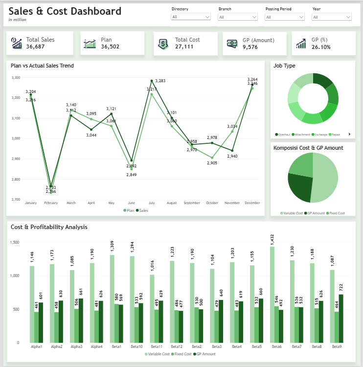

# Dashboard Sales & Cost (Power BI)

## Ringkasan

Repositori ini memuat dashboard Power BI untuk memantau penjualan, biaya, dan profitabilitas per cabang (*branch*), disertai perbandingan realisasi terhadap target (*plan vs actual*). 
Dashboard disusun ulang berdasarkan pengalaman magang penulis di bidang Data Analyst Department Service Business & Marketing, dengan menggunakan **data simulasi**.



> **Pernyataan data:** Seluruh data dalam repositori ini merupakan data simulasi yang dibangkitkan secara acak. Repositori ini tidak memuat data, nama, maupun angka milik organisasi mana pun.

## Demo

Rekaman demonstrasi dashboard (durasi sekitar satu menit): [Lihat di sini](https://drive.google.com/drive/folders/1IW-SiEv8uHXhHDwKmM4_fVeTJua_4BhI?usp=sharing)

## Latar Belakang dan Tujuan

Pengambilan keputusan manajerial memerlukan informasi yang ringkas mengenai pencapaian penjualan, struktur biaya, dan laba kotor (*gross profit*, GP). Dashboard ini bertujuan untuk:

1. membandingkan realisasi penjualan dengan target pada setiap periode;
2. mengukur total biaya, laba kotor, dan marjin laba kotor;
3. membandingkan kinerja antar cabang dan antar direktori;
4. menggambarkan komposisi biaya serta bauran jenis pekerjaan (*job type*).

## Komponen Dashboard

| Komponen | Keterangan |
|---|---|
| Kartu KPI | Total Sales, Plan, Total Cost, GP (Amount), dan GP (%) dalam jutaan rupiah |
| Plan vs Actual Sales Trend | Perbandingan pendapatan aktual dengan target per bulan |
| Job Type | Proporsi jenis pekerjaan |
| Komposisi Cost dan GP Amount | Porsi variable cost, fixed cost, dan laba kotor |
| Cost and Profitability Analysis | Perbandingan biaya dan laba kotor antar cabang |
| Filter | Directory, Branch, Posting Period, dan Year |

## Sumber dan Struktur Data

Sumber data berada pada berkas `Data Sales & Cost_Simulasi.xlsx` dengan struktur sebagai berikut.

| Lembar | Isi |
|---|---|
| Sheet1 | Data transaksi sebanyak 50.000 baris untuk periode 1 Januari hingga 31 Desember 2026 |
| Directory | 16 cabang beserta pengelompokannya ke dalam direktori (ALPHA dan BETA) |
| Helper | Panduan akun: pasangan G/L Account, deskripsi, dan klasifikasi Cost/Revenue |
| Job Type | Daftar jenis pekerjaan |
| Plan | Target penjualan per cabang untuk setiap bulan (Januari hingga Desember) |

Kolom utama pada Sheet1: Branch, Cost/Revenue, G/L Account, G/L Account Desc, Posting Date, Posting Period, Currency, Amount, Amt. in Loc. Cur, dan Job Type.

### Pembangkitan Data Simulasi

Data dibangkitkan menggunakan Python (pandas dan NumPy) pada Google Colab dengan ketentuan berikut:

- Cabang, G/L Account, dan Job Type dipilih secara acak dari lembar panduan, dan setiap baris mempertahankan kesesuaian pasangan G/L Account, deskripsi, serta klasifikasi Cost/Revenue sesuai lembar Helper.
- Tanggal posting dibangkitkan sepanjang tahun 2026, dan Posting Period diisi sesuai nomor bulan.
- Mata uang ditetapkan IDR, dan nilai Amt. in Loc. Cur sama dengan Amount.
- Nilai pendapatan berada pada rentang 100.000 hingga 5.000.000. Nilai biaya diskalakan per cabang per bulan sehingga total biaya lebih kecil daripada total pendapatan.
- Target pada lembar Plan disusun dari pendapatan aktual dengan variasi sekitar ±15% dan dibulatkan ke jutaan.

## Metodologi

1. **Pemodelan data.** Tabel Directory berperan sebagai tabel dimensi (sisi *one*), sedangkan Sheet1 dan Plan sebagai tabel fakta (sisi *many*). Relasi dibentuk melalui kolom Branch dengan kardinalitas *one to many* dan arah filter tunggal, sehingga satu filter Directory berlaku pada data transaksi dan target secara bersamaan.
2. **Transformasi data (Power Query).** Tabel Plan diubah dari format lebar menjadi format panjang (*unpivot*). Kolom nomor bulan dibentuk dari nama bulan berbahasa Indonesia menggunakan fungsi `List.PositionOf`, sehingga tidak bergantung pada pengaturan bahasa sistem. Tipe data setiap kolom disesuaikan.
3. **Ukuran (DAX).** Total Sales, Total Cost, GP (Amount), dan GP (%).
4. **Desain visual.** Palet warna hijau monokromatik, dengan kartu KPI di bagian atas, tren di bagian tengah, dan analisis per cabang di bagian bawah.

## Contoh Analisis yang Dapat Dilakukan

- Pencapaian penjualan terhadap target secara keseluruhan maupun per periode.
- Marjin laba kotor keseluruhan serta cabang dengan marjin tertinggi dan terendah.
- Dominasi variable cost atau fixed cost dalam struktur biaya.
- Perbandingan kinerja direktori ALPHA dan BETA.

## Keterbatasan

- Data bersifat simulasi sehingga angka dan pola pada dashboard bukan merupakan temuan bisnis yang sebenarnya.
- Target (Plan) disusun dari pendapatan aktual, sehingga capaian terhadap target cenderung mendekati 100% dan tidak mencerminkan akurasi perencanaan.
- Fluktuasi penjualan antar bulan sebagian besar dipengaruhi oleh jumlah hari dalam bulan dan proses pengacakan, bukan oleh pola musiman bisnis.

## Struktur Repositori

```
powerbi-sales-cost-dashboard/
├── README.md
├── Sales_Cost.pbix
├── Data Sales & Cost_Simulasi.xlsx
├── Dashboard-Sales-Cost.png
└── Dashboard-Sales-Cost.mp4

```

## Cara Penggunaan

1. Unduh `Sales_Cost.pbix` dan `Data Sales & Cost_Simulasi.xlsx`.
2. Buka `Sales_Cost.pbix` menggunakan Power BI Desktop (Windows).
3. Apabila sumber data tidak ditemukan, arahkan ke lokasi `Data Sales & Cost_Simulasi.xlsx` melalui *Transform data > Data source settings*.

Pengguna yang tidak memiliki Power BI Desktop dapat melihat tangkapan layar pada berkas Dashboard-Sales-Cost.png atau rekaman demonstrasi pada bagian Demo.

## Perangkat yang Digunakan

Power BI Desktop, Power Query, DAX, Python (pandas, NumPy), Google Colab, dan Microsoft Excel.

## Penulis

Yasyfa Maisun Majidah · [LinkedIn](https://linkedin.com/in/yasyfa-maisun) · [Email](mailto:yasyfa.maisun01@gmail.com)
